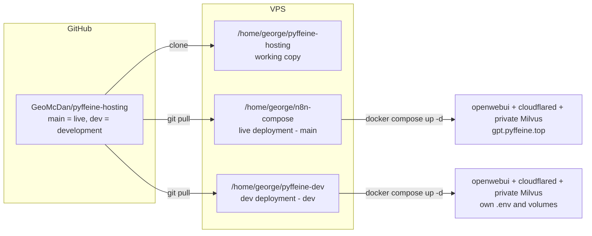

# pyffeine-hosting

Docker Compose stack hosting **OpenWebUI** and a private **Milvus** vector database behind a **Cloudflare Tunnel** on a Contabo VPS.

- Live site: <https://gpt.pyffeine.top>
- Stack: `openwebui` (ghcr.io/open-webui/open-webui), `milvus` (standalone with etcd and MinIO), and `cloudflared` (cloudflare/cloudflared)

## Architecture



## Repo Layout

```
.
├── docker-compose.yml    # openwebui + private Milvus + cloudflared
├── .env.example          # template - copy to .env, never commit real .env
├── .gitignore            # .env, *.bak, *.log, ...
├── pyffeine.sh           # unified command entry point
├── scripts/
│   ├── deploy.sh          # update deployment and restart stack
│   ├── pull-images.sh     # pull images without restarting
│   ├── start-stack.sh     # apply local Compose files without Git updates
│   └── follow-logs.sh     # follow Compose logs
└── README.md
```

## Branch Strategy

| Branch | Environment | Deployment dir on VPS |
|--------|-------------|-----------------------|
| `main` | live (production) | `/home/george/n8n-compose` |
| `dev`  | development      | `/home/george/pyffeine-dev` |

`prod` and `live` are equivalent names for the production deployment. Work on `dev`, test,
then merge to `main` and deploy production.

## Secrets Handling

- The real `.env` **never** lives in this repo — it is gitignored.
- Each deployment dir keeps its own local `.env` (untracked, preserved across `git pull`).
- Use `.env.example` as the template for new environments.

## One-Time Setup (VPS)

### 1. Working copy

```bash
mkdir -p /home/george/pyffeine-hosting
cd /home/george/pyffeine-hosting
git init -b main
git remote add origin git@github.com:GeoMcDan/pyffeine-hosting.git
# copy the cleaned tree, including pyffeine.sh and scripts/
git add .
git commit -m "chore: initial clean structure (openwebui + cloudflared)"
git branch dev
git push -u origin main dev
```

> Note: this force-replaces the old single-commit history. If the remote already has
> commits you want to keep, use `git push --force` after confirming the old history
> contains no secrets (it does not — `.env` was never committed).

### 2. Live deployment dir

```bash
cd /home/george/n8n-compose
rm -rf .git                      # drop the old in-place repo
git init -b main
git remote add origin git@github.com:GeoMcDan/pyffeine-hosting.git
git fetch origin
git checkout -b main origin/main
# .env stays in place (untracked, gitignored)
```

### 3. Dev deployment dir

```bash
git clone -b dev git@github.com:GeoMcDan/pyffeine-hosting.git /home/george/pyffeine-dev
cd /home/george/pyffeine-dev
cp .env.example .env             # fill in dev values
```

## Update Workflow

```bash
# on the VPS, from the working copy
cd /home/george/pyffeine-hosting
git checkout dev
# ... edit files, commit, push ...

# deploy to dev
./pyffeine.sh deploy dev

# merge to main and deploy live
git checkout main
git merge dev
git push origin main
./pyffeine.sh deploy live
# Equivalent production target:
./pyffeine.sh deploy prod
```

The `deploy` command checks out the target branch in the selected deployment directory, pulls it,
validates the Compose configuration with `docker compose config`, then applies it with
`docker compose up -d`.

`./pyffeine.sh pull <prod|live|dev>` validates the selected deployment's Compose configuration and
pulls its configured service images without syncing Git or restarting/recreating any
containers. Run `./pyffeine.sh deploy` afterward when you are ready to apply the images. Since the
pull helper intentionally does not sync Git, it uses the Compose file currently present in
the selected deployment directory.

Use `./pyffeine.sh logs <prod|live|dev>` to follow logs for the selected deployment. For example,
`./pyffeine.sh logs prod` follows the production stack using the `pyffeine-prod` project name.

### Start a stack from local changes

Use `./pyffeine.sh start <prod|live|dev>` to apply the files currently in a deployment directory, including
staged, unstaged, and untracked changes. It never checks out a branch or pulls Git updates.
It does fetch the target branch from `origin` to check whether the checkout has diverged.
It must be run from the exact directory for the selected environment, so selecting
`prod` or `live` from `/home/george/pyffeine-dev` is rejected even with `--yes`:

```bash
cd /home/george/pyffeine-dev
./pyffeine.sh start dev

cd /home/george/n8n-compose
./pyffeine.sh start prod
```

When the worktree/index is dirty, the checked-out branch is unexpected, `HEAD` differs
from the fetched `origin/<branch>` commit, or that remote-tracking commit is unavailable,
the script displays the condition and asks for confirmation. If the fetch fails or no
tracking commit is available, it warns that divergence could not be checked reliably.
Pass `--yes` to `./pyffeine.sh start` to acknowledge these warnings non-interactively; it does not bypass the
directory guard.

Before starting, the script validates the resolved Compose configuration and uses the
environment's fixed project name (`pyffeine-prod` or `pyffeine-dev`). `docker compose
up -d` can recreate services when configuration changes, and Compose may pull container
images according to its image/pull policy; the script's no-pull guarantee applies to
Git only. Review changes carefully, especially volume names, external volumes, ports,
and tunnel configuration. The script does not run `down` or remove orphaned containers.
## Concurrent Development and Production Deployment

Production and development use separate Docker Compose projects, Cloudflare tunnels, application containers, and external Docker volumes.

| Environment | Hostname | Volume | Tunnel |
|---|---|---|---|
| Production | `gpt.pyffeine.top` | `open_webui_data` | Production tunnel |
| Development | `dev‑gpt.pyffeine.top` | `open_webui_data_dev` | Development tunnel |

Create the development volume once:

```bash
docker volume create open_webui_data_dev
```

The volume must exist before starting the development deployment. A newly created development volume contains no Open WebUI data, users, models, or knowledge‑base content. Decide whether development should remain empty or whether data must be copied from production using a controlled backup and restore procedure.

Start production:

```bash
docker compose \
  --project-name pyffeine-prod \
  --env-file .env.prod \
  up -d
```

Start development:

```bash
docker compose \
  --project-name pyffeine-dev \
  --env-file .env.dev \
  up -d
```

Both projects may run concurrently.

## Milvus Vector Database

OpenWebUI is configured with `VECTOR_DB=milvus` and connects to `http://milvus:19530` using the Compose-internal network. Milvus standalone is backed by etcd and MinIO; their data, along with Milvus local state, is persisted in project-scoped Compose volumes. The Milvus, etcd, and MinIO services publish no host ports and are not routed through Cloudflare Tunnel. Only OpenWebUI is reachable through the tunnel.

The first startup initializes a new Milvus store. Switching OpenWebUI from the previously configured Qdrant service does not copy its existing vectors or knowledge collections. Existing knowledge documents may need to be re-indexed in OpenWebUI; keep the old Qdrant data until the new Milvus-backed setup has been verified. Production and development deployments use separate Compose projects, so their Milvus data volumes are isolated.


## Troubleshooting

| Symptom | Fix |
|---------|-----|
| `docker compose config` fails | Check `.env` exists in the deployment dir and all vars are set |
| Site down after deploy | `docker compose logs -f` in the deployment dir |
| Tunnel not connecting | Verify `CLOUDFLARED_TOKEN` in `.env` matches the Cloudflare tunnel |
| `.env` missing after clone | `cp .env.example .env` and fill in values |
