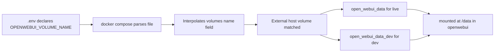

# Volume Isolation Design for pyffeine-hosting

## Context

The current Docker Compose stack (`docker-compose.yml`) defines two external volumes (`openwebui_data`, `openwebui_data_dev`) with corresponding host‑volume names (`open_webui_data`, `open_webui_data_dev`). The service mount uses an environment‑driven variable `${OPENWEBUI_VOL}:/data` to select which volume is mounted.

**Goal:** Allow the same compose file to be used for both live and dev deployments, each mounting a separate host volume, while avoiding the footguns of the current draft.

## Current Draft Analysis

### Files

- [`docker-compose.yml`](../docker-compose.yml:6‑12) – defines two external volumes:
  ```yaml
  volumes:
    openwebui_data:
      external: true
      name: open_webui_data
    openwebui_data_dev:
      external: true
      name: open_webui_data_dev
  ```
- [`docker-compose.yml`](../docker-compose.yml:42) – mount line:
  ```yaml
      - ${OPENWEBUI_VOL}:/data
  ```
- [`.env.example`](../.env.example:21) – template variable:
  ```bash
  OPENWEBUI_VOL=openwebui_data
  ```
- [`.env`](../.env:21) – dev deployment currently sets:
  ```bash
  OPENWEBUI_VOL=openwebui_data_dev
  ```

### How Docker Compose Interprets This

1. `${OPENWEBUI_VOL}` is interpolated from the `.env` file (or shell).
2. The resulting value must match a **top‑level volume key** (`openwebui_data` or `openwebui_data_dev`) for the mount to refer to the corresponding external volume.
3. If the value equals the **external name** (`open_webui_data`), Compose does **not** find a matching key and silently creates a new **project‑managed** volume with that name. This can cause:
   - Name collision with the existing external volume (error on `up`)
   - Or, worse, the service mounts an empty managed volume, losing the live data.

### Why This Is Fragile

- The user must know the internal volume key, not the external name.
- Both volumes are always declared, even though only one is used.
- No validation that the chosen volume actually exists as external.

## Recommended Pattern

Drive the **external `name:` field** via environment variable, keep the mount key stable, and retain `external: true` for fail‑fast behavior.

### Changes

**1. `docker-compose.yml` – single external volume block**
```yaml
volumes:
  openwebui_data:
    external: true
    name: ${OPENWEBUI_VOLUME_NAME}
```

**2. Service mount – stable key**
```yaml
    volumes:
      - openwebui_data:/data
```

**3. `.env` / `.env.example` – set the external name directly**
```bash
OPENWEBUI_VOLUME_NAME=open_webui_data        # live
# OPENWEBUI_VOLUME_NAME=open_webui_data_dev  # dev
```

### How It Works



### Benefits

- **Fail‑fast:** If `OPENWEBUI_VOLUME_NAME` is unset or points to a non‑existent external volume, `docker compose config` (already run by [`deploy.sh`](../deploy.sh:44)) will fail with a clear error.
- **Clear separation:** The external name is directly visible in `.env`; no need to remember internal keys.
- **Single declaration:** Only one volume block, reducing clutter.
- **No silent empty volumes:** `external: true` ensures the volume must exist on the host.

## Implementation Steps

1. **Update `docker-compose.yml`** – replace the two volume blocks with a single block using `${OPENWEBUI_VOLUME_NAME}`.
2. **Update `.env.example`** – rename `OPENWEBUI_VOL` to `OPENWEBUI_VOLUME_NAME`, provide example values for live and dev, add explanatory comments.
3. **Update `.env` in dev deployment** – change variable name and ensure the value matches the dev external volume name (`open_webui_data_dev`).
4. **Update `.env` in live deployment** – after merging to main and deploying live, set `OPENWEBUI_VOLUME_NAME=open_webui_data`.
5. **Update README** – add a “Dev Isolation” section covering:
   - One‑time creation of the dev external volume: `docker volume create open_webui_data_dev`
   - Data reset caveat: switching to a fresh dev volume starts with an empty knowledge base (accept or copy live data).
   - How the environment variable drives volume selection.
6. **Verify** – run `docker compose config` in the dev deployment directory to confirm interpolation works and no syntax errors.
7. **Create dev external volume** – if it doesn’t already exist: `docker volume create open_webui_data_dev`.

## Optional Follow‑up: Full Dev Isolation

Currently the dev environment shares the same Cloudflare tunnel token and domain (`gpt.pyffeine.top`). For complete isolation:

- Create a separate Cloudflare tunnel for dev (different subdomain, e.g., `dev‑gpt.pyffeine.top`).
- Add `CLOUDFLARED_TOKEN_DEV` and `WEBUI_URL_DEV`/`CORS_ALLOW_ORIGIN_DEV` to `.env.example`.
- Use conditional variable substitution in `docker-compose.yml` (e.g., `${CLOUDFLARED_TOKEN:-${CLOUDFLARED_TOKEN_DEV}}`) or separate compose overrides.

This step is optional and can be tackled later.

## Migration Considerations

- **Live deployment** currently uses `open_webui_data`. The new variable name must be set in its `.env` after the compose change is deployed.
- **Dev deployment** currently uses `openwebui_data_dev` as the volume key; after the change it must point to the external name `open_webui_data_dev`. The dev external volume may not exist yet – create it before switching.
- **Data reset risk:** If dev was previously sharing the live volume (because `OPENWEBUI_VOL` was set to `openwebui_data`), switching to a dedicated dev volume will start with empty data. Decide whether to copy the live volume or accept the reset.

## Verification Checklist

- [ ] `docker compose config` passes in dev directory
- [ ] `docker compose config` passes in live directory (after updating `.env`)
- [ ] `docker volume ls` shows `open_webui_data_dev` exists
- [ ] Dev stack starts and mounts the dev volume (check `docker inspect openwebui`)
- [ ] Live stack continues to mount the live volume unchanged

## Files to Modify

| File | Change |
|------|--------|
| `docker-compose.yml` | Replace two volume blocks with one interpolated block |
| `.env.example` | Rename `OPENWEBUI_VOL` → `OPENWEBUI_VOLUME_NAME`, add live/dev examples |
| `README.md` | Add “Dev Isolation” section, volume creation instructions, caveat |
| `.env` (dev) | Update variable name and value |
| `.env` (live) | Update after merging to main |

## Decision Points

- **Keep current draft?** Not recommended – the footgun is real and could cause data loss.
- **Interpolate the volume key instead of the name?** Possible but still requires two volume blocks; the recommended pattern is cleaner.
- **Add a default fallback?** Use `${OPENWEBUI_VOLUME_NAME:-open_webui_data}` to provide a default, but `external: true` will still fail if the default volume doesn’t exist – acceptable.

## Next Actions

1. Review this plan.
2. If approved, switch to **Code mode** to implement steps 1‑5.
3. After implementation, run verification steps.
4. Optionally proceed with full dev isolation (tunnel token + domain).